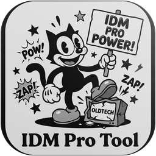

<p align="right">
  <strong>English</strong> | <a href="README.zh.md">简体中文</a>
</p>

<p align="center">
  
</p>

<h1 align="center">IDM Pro Tool</h1>

<p align="center">
  <strong>Feature-Rich Native C# Activation & Lifecycle State Maintenance Toolkit for Internet Download Manager</strong>
</p>

<p align="center">
  <a href="https://github.com/angusdevgo/IDM_Pro_Tool/stargazers"></a>
  <a href="https://github.com/angusdevgo/IDM_Pro_Tool/releases"></a>
  <a href="https://github.com/angusdevgo/IDM_Pro_Tool/blob/main/LICENSE"></a>
  
  
  
</p>

<p align="center">
  <a href="#-key-features">Key Features</a> •
  <a href="#-functional-overview">Functional Overview</a> •
  <a href="#-core-architecture--mechanisms">Core Mechanisms</a> •
  <a href="#-quick-start">Quick Start</a> •
  <a href="#-command-line-interface-cli">CLI Support</a> •
  <a href="#-verified-versions--cryptographic-fingerprints">Verified Versions</a> •
  <a href="#-project-structure">Project Structure</a> •
  <a href="#-open-source-license">License</a> •
  <a href="#-disclaimer">Disclaimer</a>
</p>

---

## 🌟 Key Features

- 🚀 **Zero External Dependencies · Native Toolchain Execution**  
  No heavyweight .NET SDK, Visual Studio, or runtime prerequisites required. Compiles within milliseconds using the built-in Windows native C# compiler (`csc.exe`), producing a standalone executable of approximately 240 KB.
- 🎨 **Code-First Modern WPF Interface**  
  Constructed entirely in pure C# code without any XAML overhead. Integrates native Windows Desktop Window Manager (DWM) immersive dark-mode titlebars and built-in Per-Monitor High-DPI dynamic scaling.
- 🛡️ **Byte-Level Preflight Safety Gating**  
  Validates both structural PE headers and redundant expected byte sequences prior to any modification. Aborts immediately with a zero-byte-written fail-closed guarantee upon any fingerprint or layout mismatch.
- 💾 **Version-Aware Atomic Backup & Restoration**  
  Automatically archives clean original binaries to `IDMan.exe.BAK`. Inspects embedded version metadata to detect stale backups from past updates, preventing rollback version misalignment.
- ⚡ **Multi-Paradigm Activation Strategies**  
  Consolidates deep binary patching, Windows ACL registry evaluation freezing, and personalized identity registration into a single modular solution.
- 🌐 **Full Bilingual Architecture (English & Simplified Chinese)**  
  Auto-detects Windows OS locale upon startup with a persistent `[ 🌐 EN / 简 ]` sidebar capsule toggle for instant in-memory language switching across all controls, dialogs, and live console logs.

---

## 📋 Functional Overview

### 1. Core Operating Modes

| Mode | Underlying Mechanism | Recommended Scenario |
| :--- | :--- | :--- |
| 🔥 **Mode 1: Rapid Deep Unlock** | Scans and patches 16 instruction sites (32 bytes) in `IDMan.exe` using AOB dual-state signatures (including 1 version-adaptive optional site and the auto-update timer cutoff), strips Authenticode certificates, recomputes the PE checksum, and writes permanent license metadata. | Complete offline entitlement with all functional and dialog restrictions removed. |
| ❄️ **Mode 2: Permanent Trial Freeze** | Employs Windows Access Control Lists (ACLs) to write-protect IDM's evaluation CLSID registry keys and timestamps at a fixed 30-day trial status without altering binary code. | Users requiring unaltered PE binary hashes and compatibility with silent official in-app updates. |
| 💎 **Mode 3: Custom Identity Registration** | Injects custom user name and email credentials (with randomized identity generation) into the registry while coordinating underlying binary unlock hooks. | Customizing personalized registered ownership displays in the IDM interface. |
| 🔄 **Mode 4: Factory Reset & State Cleanup** | Purges evaluation CLSID registry markers, known blacklist records, telemetry flags, and leftover state, restoring IDM to a clean post-installation state. | Resolving corrupted state, notification anomalies, or preparing for clean testing. |
| ♻️ **One-Click Official Restore** | Restores the unpatched binary from `IDMan.exe.BAK`, strips registration keys, and returns IDM to an unactivated trial state. | Quick, zero-side-effect rollback to stock condition. |

### 2. Security Shields & Maintenance Utilities

- **🛡️ Hosts Loopback Shield**: Intelligently toggles `127.0.0.1` loopback mappings in the Windows `hosts` file for 8 primary verification servers (e.g., `tonec.com`, `registeridm.com`), severing network-layer telemetry and serial blacklisting.
- **⚙️ Official Update Policy Control**: Toggles the `CheckUpdtVM` registry policy to silence automated update prompts or re-enable them on demand.
- **🧰 Registry & Path Utilities**:
  - **📍 Custom IDM Path Resolution**: Full support for non-system drives (D:\, E:\, etc.) and portable installations with automatic polling, interactive file selection dialogs, and persistent configuration memory.
  - One-click navigation to the IDM installation directory.
  - One-click launch and deep-navigation to `HKEY_CURRENT_USER\Software\DownloadManager` in Windows Registry Editor.
  - Complete one-click registry configuration export to the desktop (`IDM_Reg_Backup.reg`).
- **⚡ Process Control**: Safe single-click termination, execution, and restart of the IDM core process.

---

## 🔬 Core Architecture & Mechanisms

```
[Stock IDMan.exe] ──> [PE Structural Integrity Check] ──> [AOB Dual-State Signature Scan]
                               │
                               ├──> 1. AOB Signature Scan & Patch (16 sites / 32 bytes)
                               ├──> 2. Zero Authenticode Directory & Truncate 10,608-byte Overlay
                               ├──> 3. Standard PE Checksum Recomputation (Microsoft Algorithm)
                               ├──> 4. Pre/Post-Write Dual PE Validation with Atomic Rollback
                               └──> 5. Purge Counterfeit Serial & Register Valid Entitlement
```

### 0. AOB Pattern Signature Scanning Engine (v3 Architecture Core)

Legacy solutions (v2 and earlier) relied on **hardcoded file offsets**. Each minor IDM maintenance release involves full re-compilation, inducing **non-uniform code relocations** (e.g., shifts ranging non-linearly from −896 to +64 bytes between 6.43 build 10 and build 11). Fixed offsets inevitably corrupt executable code sections, triggering fatal Win32 errors such as `0x80004005: The specified executable is not a valid application for this OS platform`.

The **v3 architecture** transitions to an **Array of Bytes (AOB) Pattern Signature Scanning Engine**:

1. Each patch target defines both **Pristine** (`SigOriginal`) and **Patched** (`SigPatched`) byte signatures.
2. The engine scans for `SigPatched` first to ensure seamless idempotency across multiple runs.
3. Signatures require **strict unique matching** across the entire binary image, coupled with redundant `Expected` byte checks at the computed relative offset.
4. If **any required site** fails to match, the engine aborts with zero disk modifications.
5. Signatures are derived from **cross-version common invariant regions**, filtering out compiler-generated relocation pointers.

> Current signatures are validated across **seven releases**: **6.43 build 10**, **build 11 (6.43.11.2)**, **build 11 (6.43.11.3)**, **build 12 (6.43.12.3)**, **build 15 (6.43.15.3)**, **build 16 (6.43.16.3)**, and **build 18 (6.43.18.3)**.  
> The **15 required sites** match uniquely across all seven versions (including Site #16 which cuts off the background auto-update timer).  
> The **16th entry (Site #15)** is an optional version-adaptive patch targeting the build 11.3+ registration dialog behavior (see §0.2); it does not exist in build 10 / 11.2 and is skipped automatically.

### 0.1 Version-Aware Backup Mechanism (Preventing Stale Rollback Points)

When a user updates IDM, an existing `IDMan.exe.BAK` in the target directory often contains the stock binary of the **previous version**. Unconditionally reusing this file leads to version skew:
- Rollback snapshots point to an outdated release.
- Restoring the backup overwrites the updated installation with obsolete binaries, creating runtime DLL interface mismatches.

This toolkit enforces a **Version-Aware Backup Protocol**:

| Scenario | Engine Action |
| :--- | :--- |
| `BAK` missing | Creates backup immediately from current binary. |
| `BAK` version == Current version | Preserves existing backup without modification. |
| `BAK` version ≠ Current version & Current binary is pristine | Archives outdated backup to `IDMan.exe.BAK.<oldVer>` and captures clean backup of new release. |
| `BAK` version ≠ Current version & Current binary is already modified | **Refuses to overwrite backup**, protecting user rollback safety. |

Additionally, the restoration module enforces a **Version Consistency Guard**, rejecting restore operations if the backup version differs from installed companion components.

### 0.2 Optional-Site Mechanism (Version-Adaptive Patching)

Certain anti-piracy branches only exist in specific compiler builds (e.g., defensive checks introduced in newer maintenance revisions). Requiring unanimous matching across all points causes the engine to falsely reject legacy releases.

Version 1.4.0 introduces the `AobPoint.Optional` flag:

| Site Classification | Pattern Found | Pattern Not Found |
| :--- | :--- | :--- |
| **Required Site** | Patches binary. | **Aborts operation with zero disk writes.** |
| **Optional Site** | Patches binary. | Logs informational message and **continues without error**. |

Preflight gating requires that all required sites are satisfied: `requiredOk == requiredCount`.

**Multi-Version Adaptability Matrix**:

| Release Target | Matched Sites | Resulting Binary Hash |
| :--- | :--- | :--- |
| **build 10** | 15 / 16 (Optional skipped) | `69F95587…` — Site #16 Active |
| **build 11 (11.2)** | 15 / 16 (Optional skipped) | `0A22C48B…` — Site #16 Active |
| **build 11 (11.3)** | **16 / 16** | `02627D24…` — All Active |
| **build 12 (12.3)** | **16 / 16** | `51088CC0…` — All Active |
| **build 15 (15.3)** | **16 / 16** | `5891512A…` — All Active |
| **build 16 (16.3)** | **16 / 16** | `8F77A3E8…` — All Active |
| **build 18 (18.3)** | **16 / 16** | `DED287E0…` — All Active |

### 0.3 Build 15 (6.43.15.3) — Silent Auto-Update Invalidation

**Observed failure mode**: IDM's built-in updater silently replaced the already-activated `IDMan.exe` with a freshly downloaded stock build 15 binary, resetting the entitlement state back to `v6.43b15 Trial` (CWE-602 — the privilege decision is enforced entirely client-side).

The v1.4.0 engine correctly **refused to write** (9 of 15 signatures missed, zero bytes flushed), leaving the user with an unactivated but uncorrupted binary. Extending coverage to build 15 required two non-trivial adaptations:

1. **Shrinking common-invariant region** — build 15 re-compiled a substantial portion of `.text`, so the byte region shared verbatim by all five releases contracted. Signatures were regenerated from the five-version intersection, which naturally narrowed them (e.g. `授权分支检测` 118 B → 24 B) while every site retained **dual-state uniqueness (1/1)**.
2. **Non-uniform padding drift in `.data`** — the trial-flag/day-limit constant block gained two extra zero-padding bytes ahead of the `01 00 00 00 / 1E 00 00 00` pair. Naive sliding-Hamming matching therefore locked onto a near-miss location two bytes early (Hamming distance 2, wrong patch offset `0x379546`). The site was re-anchored by exact byte search to **`0x379524`** and confirmed by capstone disassembly.

**Verification discipline applied**: every located site was cross-checked by (a) exact expected-byte match, (b) capstone semantic disassembly compared side-by-side against the build 11.3 baseline, and (c) an end-to-end patch whose diff offsets were asserted to fall **only** within patch sites ∪ PE checksum ∪ security directory.

### 0.4 Site #16 — Startup Auto-Update Timer Cutoff & Proxy Error Root Cause

**Observed failure mode**: Users reported recurring error dialogs stating *"Cannot connect to target server... Cannot connect to proxy server 127.0.0.1:XXXX"* during normal usage.

**Reverse Engineering Revelation**:
1. Legacy activators blindly deleted `LastCheckQU` under the false assumption that it was a telemetry tracking key. In reality, `LastCheckQU` represents **Last Check Quick Update**! Deleting this key signals to IDM that QuickUpdate has never been executed, causing it to **force an immediate update check on every startup**.
2. IDM's update check attempts to connect to official servers using the Windows Internet (WinINET) proxy. If the user's proxy tool is stopped, misconfigured, or on a different port, IDM throws the proxy connection failure dialog.
3. The common practice of writing `CheckUpdtVM = 0` was an **unverified urban legend**: decompilation proves IDMan.exe **never reads `CheckUpdtVM`**; it only writes `"10"` to it.

**Architectural Fix**:
- **Binary Patch #16**: Patches `IDMan.exe` startup logic (`0x00076B27` in b15.3, `75 19` → `EB 19`), unconditionally jumping over `SetTimer(..., 0x22, 225000ms)`. The background update timer is **never created**, cutting off all background update polling at the root.
- **Registry Normalization**: `LastCheckQU` is removed from the deletion list and populated with a valid timestamp, preventing legacy code branches from triggering urgent update checks.

---

### 0.5 Build 16 (6.43.16.3) — Code Relayout & the +245 KB `.text` Expansion

**Observed failure mode**: After an official silent update to build 16, the registration dialog (resource ID 138) reappeared despite a previously successful activation.

**Root cause**: Build 16 is not a minor revision. Compared with build 15.3, `.text` grew by **250,864 bytes (+245 KB)** and `.reloc` by 10,736 bytes, while `.rsrc` stayed byte-identical in size. Section virtual addresses shifted by `+0x3D000` (`.rdata`) through `+0x44000` (`.rsrc`/`.reloc`). Against the v1.6.0 five-release signature table, only **5 of 16 sites** still matched — the fail-closed engine therefore **wrote zero bytes**, leaving the binary stock and the entitlement at `v6.43b16 Trial`. The dialog was a symptom, not a new anti-tamper mechanism.

**Extension work performed**:

1. **Locating the ten missing sites** — a generalised sliding-Hamming locator was run with build 15.3 offsets as the reference. All ten resolved at Hamming distances of **3–10** over a 64-byte window (random expectation ≈ 62), i.e. pure code displacement rather than semantic rewrite. In-section shift was non-uniform: `+0x1D0` to `+0x5E0`.
2. **Semantic verification** — every located site was re-disassembled with capstone in both build 15.3 and build 16.3. All 15 code sites land on an instruction boundary with an identical mnemonic (`test eax,eax`, `and eax,0xf`, `push -1`, `push ebp`, `je`, `jne`, `jne rel32`), and the `.data` constant block is byte-identical. Site #12 is an **operand patch** (`mov eax,1` → `mov eax,0`), not an opcode patch — the only site where the patch offset lands inside an instruction.
3. **Signature regeneration across six releases** — adding build 16 narrowed the common invariant region further. A `0x69` byte immediately left of Site #1 became `0x6D` in build 16, so the left extension contracted from 2 bytes to 1. Signature length is capped at **48 bytes** per site: long enough to make accidental collisions implausible, short enough to tolerate future code drift. Total table size: **366 bytes across 16 sites (avg 22.9 B/site)**.
4. **Zero regression on legacy releases** — patched output hashes for builds 10, 11.2, 11.3, 12.3 and 15.3 are **byte-identical** to v1.5.1. Two independent implementations (the C# engine and a standalone Python reference patcher) produce the same SHA-256 for build 16.3, cross-validating the patch semantics.

**Verification discipline applied**: the differential byte audit confirms **32 changed bytes** in the overlapping region — all inside patch sites ∪ PE checksum ∪ security directory — plus a 10,608-byte Authenticode tail truncation. Nothing outside the whitelist changed.

### 0.6 Build 18 (6.43.18.3) — Zero-Drift Reflow & the Return on the 48-Byte Signature Cap

**Observed failure mode**: After an official silent update to build 18, both the registration dialog and the trial-countdown popup reappeared, with `idmvers` reset to `v6.43b18 Trial`.

**Root cause**: Build 18 skipped build 17 entirely and re-compiled `.text` again — but in the **opposite direction** from build 16:

| Section | build 16 | build 18 | Delta |
| :--- | ---: | ---: | ---: |
| `.text` raw | 0x2D0600 | 0x2D6600 | **+24,576** |
| `.rdata` raw | 0xEB800 | 0xEBE00 | +1,536 |
| `.data` raw | 0xA800 | 0xA800 | **±0** |
| `.rsrc` raw | 0x22D800 | 0x22D800 | **±0** |
| `.reloc` raw | 0x39E00 | 0x3A000 | +512 |
| File size | 6,490,480 | 6,517,104 | +26,624 |

Every section VA shifted by exactly `+0x6000` (except `.text`, which still starts at `0x1000`). Unlike build 16 — where in-section code shifted *forward* by `+0x1D0`…`+0x5E0` — build 18 compacts code *backward* by **`-0x320`…`-0x9A0`**, while the data segment moves forward by `+0x6600` (`0x3BCF24` → `0x3C3524`). A negative direction change is normally the harder case for signature matching, because the drift accumulates in the opposite sense from the last calibration.

**Extension work performed — and what did *not* need doing**:

1. **Exact-match pre-check first** — before any Hamming search, the v1.6.1 table was run verbatim against build 18. Result: **16 / 16 sites matched exactly, at Hamming distance 0**. No signature regeneration was required at all.
2. **Why the 48-byte cap paid off** — build 18's displacement magnitude (`-0x9A0`) exceeds build 16's (`+0x5E0`), yet the table survived unchanged. A shorter, minimum-sufficient table (the 142-byte variant rejected during v1.6.1) would have collided; the chosen 48-byte cap keeps 22.9 B average length while carrying enough context to bridge a 2.4 KB inter-version shift.
3. **Semantic re-verification anyway** — all 16 sites were re-disassembled with capstone against build 18. Fifteen code sites still land on instruction boundaries with unchanged mnemonics (`test eax,eax`, `and eax,0xf`, `push -1`, `push ebp`, `je`, `jne`); Site #12 remains the sole **operand patch** (`mov eax,1` at `0x995F0`, patched byte at `+1` → `mov eax,0`); the `.data` constant block is byte-identical.
4. **Structural forensics for new anti-tamper** — the UTF-16 resource string diff between build 16 and build 18 yields only **10 new strings**, none of them license-, trial-, or update-related (they are `6, 43, 18, 3`, a sound-path template, a SOCKS dialog fragment, `gnlaapi.dll`, `TLS13_OFF`, `English`). Conclusion: no new defensive mechanism was introduced; the failure was pure binary reflow.

**Verification discipline applied**: the differential byte audit reports **33 changed bytes** in the overlapping region — 26 patch-site bytes + 4 checksum bytes + 4 security-directory bytes (8 zeroed, 4 of which were already zero) — **zero outside the whitelist** — plus a 10,608-byte Authenticode tail truncation. Patched output is 6,506,496 bytes (`pe.ImageEnd`), SHA-256 `DED287E0…F03CE954`, PE checksum `0x006371AE`.

**Runtime confirmation**: cold start of the patched build 18 yields exactly **one** visible window (`#32770`, title `Internet Download Manager 6.43` — no `(Trial)` suffix), no registration dialog, no trial-countdown popup, and IDM self-reports `idmvers = v6.43b18 Full` in `HKCU\Software\DownloadManager`.

> **Methodology takeaway**: the value of a version-adaptive signature table is measured not by how many releases it was *built* from, but by how many releases it *works on without being rebuilt*. Build 18 was absorbed with a zero-byte table change — the first such release in this project's history.

---

---

### 1. Dual-Layer Defense: Registry Strategy & Binary Branch Override

IDM performs asymmetric cryptographic signature checks on the `Serial` registry value. Supplying an arbitrary or synthetic serial triggers counterfeit detection alarms.

**Registry Layer (Policy Surface)**:
1. **Purge** the `Serial` key to bypass public-key validation routines.
2. Clean telemetry tracking keys: `scansk`, `tvfrdt`, `radxcnt`, `ptrk_scdt`, `LastCheckQU`, `scTime`, `NextCheck`, `BList`, `md5pks`.
3. Populate identity keys: `FName`, `LName`, and `Email`.

> ⚠️ **Key Insight (v1.4.0)**: **Deleting `Serial` alone is insufficient in build 11.3**.  
> Build 11.3 introduced a defensive check: **if the `Serial` key is absent on launch, IDM immediately forces the registration modal dialog** (Dialog Resource ID 138).  
> Version 1.4.0 adds Site #15 at the binary decision level (`je` → `jmp`), forcing execution down the "Serial present and verified" path, establishing a **dual-layer defense**.  
>  
> *Architectural Principle*: Registry keys represent a volatile policy surface subject to vendor modification; binary conditional branches represent the invariant decision surface.

### 2. Authenticode Stripping & PE Checksum Normalization

Patching code sections invalidates the official Authenticode digital signature, causing security subsystems to flag the executable as tampered.  
This toolkit parses the PE image dynamically:
- Clears `VirtualAddress` and `Size` in `IMAGE_DIRECTORY_ENTRY_SECURITY` (Data Directory index 4).
- Truncates the physical 10,608-byte digital certificate block appended to the file overlay (e.g., resizing build 11.3 from 6,200,176 to exactly 6,189,568 bytes, or build 15.3 from 6,201,712 to exactly 6,191,104 bytes, or build 16.3 from 6,490,480 to exactly 6,479,872 bytes — all matching `pe.ImageEnd`).
- Recomputes the PE Checksum using the standard Microsoft folding addition algorithm, restoring binary structural compliance.

---

## 🚀 Quick Start

### Method 1: Pre-Compiled Release Binary

1. Download the latest archive from the [Releases Page](https://github.com/angusdevgo/IDM_Pro_Tool/releases).
2. Extract the archive, ensuring `app_icon.png` resides alongside `IDM_Pro_Tool.exe`.
3. Right-click `IDM_Pro_Tool.exe` and select **Run as administrator**.
4. Select your desired mode from the interface and click execute.

### Method 2: Compile from Source

Compiles natively on any modern Windows environment (Windows 10 / 11 includes .NET Framework 4.x out of the box). Clone the repository and run `build.bat`:

```powershell
# 1. Clone the repository
git clone https://github.com/angusdevgo/IDM_Pro_Tool.git
cd IDM_Pro_Tool

# 2. Execute the native build script
.\build.bat
```

> **Build Details**: `build.bat` invokes `%WINDIR%\Microsoft.NET\Framework64\v4.0.30319\csc.exe` directly, completing compilation in 1–2 seconds with zero toolchain overhead.

---

## 💻 Command Line Interface (CLI)

The toolkit features full headless command-line support for automation scripts, unattended deployments, and CI/CD pipelines:

```powershell
# Execute Mode 1: Rapid Deep Unlock (AOB binary patch + registration)
IDM_Pro_Tool.exe -patch

# Execute Mode 2: Permanent Trial Freeze (Windows ACL evaluation lock)
IDM_Pro_Tool.exe -freeze

# Execute Mode 3: Custom Identity Registration
IDM_Pro_Tool.exe -register "VIP_User" "vip@domain.com"

# Revert to clean stock installation from BAK
IDM_Pro_Tool.exe -restore

# Explicitly configure and persist custom IDM installation path
IDM_Pro_Tool.exe -setpath "D:\Software\Internet Download Manager"

# Display CLI help documentation
IDM_Pro_Tool.exe -help
```

---

## 📂 Project Structure

```text
IDM_Pro_Tool/
├── src/
│   ├── Program.cs          # Unified source (~3000 lines, code-first WPF vector UI & patch engines)
│   ├── app.ico             # Multi-resolution application icon asset (16–256px)
│   ├── app_icon.png        # 256x256 high-resolution vector interface asset
│   └── app.manifest        # Windows UAC execution level & Per-Monitor DPI awareness manifest
├── tests/
│   ├── PatchEngineTests.cs # Automated regression harness (61 assertions across all versions)
│   ├── QuickPatch.cs       # Minimal engine CLI harness for rapid validation
│   ├── build_tests.bat     # Regression harness build script
│   └── build_quick.bat     # Standalone driver build script
├── build.bat               # Native batch compilation and asset assembly script
├── IDM_Pro_Tool.exe        # Compiled x64 Windows GUI application
├── app_icon.png            # Runtime window icon dependency
├── LICENSE                 # GNU General Public License v3.0
├── README.md               # English documentation (Default)
└── README.zh.md            # Simplified Chinese documentation
```

---

## 🔍 Verified Versions & Cryptographic Fingerprints

This toolkit is rigorously tested against official retail distribution binaries:

| Verification Item | build 10 | build 11 (6.43.11.2) | build 11 (6.43.11.3) | build 12 (6.43.12.3) | build 15 (6.43.15.3) | build 16 (6.43.16.3) | build 18 (6.43.18.3) |
| :--- | :--- | :--- | :--- | :--- | :--- | :--- | :--- |
| **Product Version** | `IDMan.exe` v6.43.10.2 | v6.43.11.2 | v6.43.11.3 | v6.43.12.3 | v6.43.15.3 | v6.43.16.3 | v6.43.18.3 |
| **Stock File Size** | 6,199,664 bytes | 6,200,176 bytes | 6,200,176 bytes | 6,200,176 bytes | 6,201,712 bytes | 6,490,480 bytes | 6,517,104 bytes |
| **Stock SHA-256** | `03CC62E9…D16D607C` | `E8B0459D…9AB9DD4E69` | `D0993EC0…7CDB194C6A` | `7B8D9ABA…099F214E` | `279CEED9…8A7CE737` | `75AC33A7…C2145285` | `67D2D6AA…25C7E686` |
| **Stock PE Checksum** | `0x005ECD00` | `0x005EF1D7` | `0x005E9C44` | `0x005EF806` | `0x005F549C` | `0x00630D90` | `0x00643BFE` |
| **Patched File Size** | 6,189,056 bytes | 6,189,568 bytes | 6,189,568 bytes | 6,189,568 bytes | 6,191,104 bytes | 6,479,872 bytes | 6,506,496 bytes |
| **Patched SHA-256 (v1.3.0)** | `712BD0D9…36FCC79CC6` | `3470B5B8…DEA6CD601D8` | `F4CF6939…20F920A5F4` | — | — | — | — |
| **Patched Checksum (v1.3.0)** | `0x005EBDA3` | `0x005E84FA` | `0x005F4B5D` | — | — | — | — |
| **Patched SHA-256 (v1.4.0)** | `712BD0D9…36FCC79CC6` | `3470B5B8…DEA6CD601D8` | `641A6D97…B6CC404763E` | — | — | — | — |
| **Patched Checksum (v1.4.0)** | `0x005EBDA3` | `0x005E84FA` | `0x005EC25E` | — | — | — | — |
| **Patched SHA-256 (v1.5.0)** | `712BD0D9…36FCC79CC6` | `3470B5B8…DEA6CD601D8` | `641A6D97…B6CC404763E` | `B9B6F951…07739B3E` | `5005D219…3F43466C` | — | — |
| **Patched Checksum (v1.5.0)** | `0x005EBDA3` | `0x005E84FA` | `0x005EC25E` | `0x005F6E1F` | `0x005EC77B` | — | — |
| **Patched SHA-256 (v1.5.1)** | `69F95587…61220F9A` | `0A22C48B…257D5AC8` | `02627D24…3AE2B0B5` | `51088CC0…ADBBB71A` | `5891512A…7780CF5D` | — | — |
| **Patched Checksum (v1.5.1)** | `0x005F33A3` | `0x005EFAFA` | `0x005F385E` | `0x005EE420` | `0x005F3D7B` | — | — |
| **Patched SHA-256 (v1.6.1)** | `69F95587…61220F9A` | `0A22C48B…257D5AC8` | `02627D24…3AE2B0B5` | `51088CC0…ADBBB71A` | `5891512A…7780CF5D` | `8F77A3E8…A029B5EE` | — |
| **Patched Checksum (v1.6.1)** | `0x005F33A3` | `0x005EFAFA` | `0x005F385E` | `0x005EE420` | `0x005F3D7B` | `0x0063A19B` | — |
| **Patched SHA-256 (v1.6.2)** | `69F95587…61220F9A` | `0A22C48B…257D5AC8` | `02627D24…3AE2B0B5` | `51088CC0…ADBBB71A` | `5891512A…7780CF5D` | `8F77A3E8…A029B5EE` | `DED287E0…F03CE954` |
| **Patched Checksum (v1.6.2)** | `0x005F33A3` | `0x005EFAFA` | `0x005F385E` | `0x005EE420` | `0x005F3D7B` | `0x0063A19B` | `0x006371AE` |

> *Note on Historical Hashes*: Legacy crack releases (e.g. v20.7) populated the PE checksum field with `0x005F0BEA`. Exhaustive algorithmic analysis proves this value corresponds to no valid Microsoft checksum standard. This toolkit writes the **mathematically valid standard checksum**.

> *Signature Invariance*: AOB patterns are anchored in multi-version invariant byte sequences, naturally immune to relocation noise. The 15 required sites match uniquely across all seven tested releases (including Site #16); Site #15 automatically activates on build 11.3+ via the `Optional` subsystem.

---

## ⚠️ Disclaimer

1. This project, including all associated source code and compiled executables, is provided **strictly for reverse engineering, Windows operating system internals, PE file structure analysis, and educational security research**.
2. Users should delete all downloaded files within 24 hours of testing. Commercial use or unauthorized redistribution is strictly prohibited.
3. If you regularly use Internet Download Manager, please support software developers by purchasing an official license at the [Official IDM Website](https://www.internetdownloadmanager.com/).
4. The author assumes no liability for software conflicts, data loss, or system instability arising from the use of this software.

---

## 📄 Open Source License

This project is licensed under the **[GNU General Public License v3.0](LICENSE)** (GPL-3.0).

### Permissions

- ✅ **Commercial Use** — May be used for any purpose, including commercial endeavors.
- ✅ **Modification** — Full freedom to inspect, research, and alter source code.
- ✅ **Distribution** — Freedom to copy, share, and redistribute.
- ✅ **Patent Grant** — Express patent grant from contributors.

### Conditions & Obligations

- 📌 **Copyleft (Reciprocal License)** — Any modified or derivative works **must also be released under GPL-3.0** with full source code made available.
- 📌 **License and Copyright Notice** — Original copyright headers and license text must be preserved in all copies.
- 📌 **State Changes** — Modified files must carry prominent notices documenting that changes were made.
- 📌 **No Additional Restrictions** — Downstream distributors may not place terms that restrict freedoms granted by GPL-3.0.

### Warranty Disclaimer

- ⚠️ **No Warranty** — The software is provided "AS IS", without warranty of any kind, express or implied.
- ⚠️ **Research Purpose** — Please consult the Disclaimer above; do not use for copyright infringement.

For full terms and conditions, consult the [LICENSE](LICENSE) file or visit <https://www.gnu.org/licenses/gpl-3.0.html>.

Issues and Pull Requests are welcome!

---

## 🤝 Community & Acknowledgements

- **LINUX DO Community**: [https://linux.do](https://linux.do)

---

## ⭐ Star History

<a href="https://star-history.com/#angusdevgo/IDM_Pro_Tool&Date">
 <picture>
   <source media="(prefers-color-scheme: dark)" srcset="https://api.star-history.com/svg?repos=angusdevgo/IDM_Pro_Tool&type=Date&theme=dark" />
   <source media="(prefers-color-scheme: light)" srcset="https://api.star-history.com/svg?repos=angusdevgo/IDM_Pro_Tool&type=Date" />
   
 </picture>
</a>
