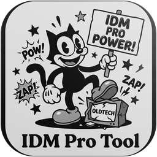

<p align="right">
  <a href="README.md">English</a> | <strong>简体中文</strong>
</p>

<p align="center">
  
</p>

<h1 align="center">IDM Pro Tool</h1>

<p align="center">
  <strong>多功能 Internet Download Manager 原生 C# 激活与状态维护套件</strong>
</p>

<p align="center">
  <a href="https://github.com/angusdevgo/IDM_Pro_Tool/stargazers"></a>
  <a href="https://github.com/angusdevgo/IDM_Pro_Tool/releases"></a>
  <a href="https://github.com/angusdevgo/IDM_Pro_Tool/blob/main/LICENSE"></a>
  
  
  
</p>

<p align="center">
  <a href="#-项目特色">项目特色</a> •
  <a href="#-功能全景">功能全景</a> •
  <a href="#-核心实现原理">核心实现原理</a> •
  <a href="#-快速开始">快速开始</a> •
  <a href="#-命令行模式-cli-support">命令行模式</a> •
  <a href="#-验证版本与指纹">验证版本与指纹</a> •
  <a href="#-项目结构">项目结构</a> •
  <a href="#-开源许可证">开源许可证</a> •
  <a href="#-免责声明-disclaimer">免责声明</a>
</p>

---

## 🌟 项目特色

- 🚀 **零外部依赖，系统原生直驱**  
  无需安装任何 .NET SDK、Visual Studio 或繁重依赖，仅使用 Windows 系统自带的 `csc.exe` 即可毫秒级编译，产物仅 200 KB 左右。
- 🎨 **纯代码构建的精美 WPF 界面**  
  零 XAML 文件，全代码手工构建高精度矢量界面，集成 Windows DWM 沉浸式暗黑标题栏，原生支持高分屏（High DPI）自适应渲染。
- 🛡️ **严格的字节级安全防护机制**  
  打补丁前严格比对目标机器上的 `Expected` 原始机器码，版本或指纹不符自动中断并安全回滚，杜绝改坏 `IDMan.exe`。
- 💾 **无损原子级安全备份**  
  首次修补时自动建立 `IDMan.exe.BAK` 原始母版备份，仅当备份不存在时创建，确保回滚点始终为官方最纯净原版。
- ⚡ **多维度激活机制集成**  
  集成「底层二进制修补」、「Windows ACL 永久冻结试用」与「个性化授权登记」三大主流策略，满足不同场景下的使用与测试需求。
- 🌐 **全球双语自适应架构 (中英双语即时热重绘)**  
  启动时自动检测 Windows 系统区域语言，并在侧边栏提供常驻 `[ 🌐 EN / 简 ]` 胶囊切换按钮，毫秒级完成全界面、交互弹窗与运行日志的双语无感热切换。

---

## 📋 功能全景

### 1. 核心授权模式 (Core Modes)

| 模式 | 运行机制 | 适用场景 |
| :--- | :--- | :--- |
| 🔥 **模式一：极速深度解锁** | AOB 特征码扫描定位 `IDMan.exe` 底层 16 处 / 32 字节指令并修补（含 1 处版本专属可选位点及启动自动更新定时器切断），剥离数字签名，重算 PE 校验和，并写入终身授权登记信息。 | 追求彻底离线激活、解除所有限制的用户。 |
| ❄️ **模式二：永久冻结试用期** | 通过 Windows ACL 精确锁定注册表 CLSID 键与时间戳，固定锁定 30 天试用；不修改任何二进制。 | 需要保持原版哈希、支持官方在线静默升级的用户。 |
| 💎 **模式三：个性化授权登记** | 自定义登记姓名与邮箱（支持一键生成随机身份），自动写入系统注册表并联动底层解锁。 | 需要自定义个人专属软件授权展示界面的用户。 |
| 🔄 **模式四：全量清理出厂重置** | 清理系统内 CLSID 试用标记、黑名单特征项及注册表残留，重置为刚安装时的纯净状态。 | 解决弹窗异常、状态混乱或准备重装测试。 |
| ♻️ **一键还原官方原版** | 一键无缝从 `IDMan.exe.BAK` 恢复原版主程序，并抹除注册项，还原为未注册评估状态。 | 快速回滚至初始状态。 |

### 2. 高级安全与策略盾牌 (Security & Shields)

- **🛡️ Hosts 验证盾牌**：智能向系统 Hosts 文件添加/移除 `tonec.com`、`registeridm.com` 等 8 组关键验证服务器的 `127.0.0.1` 回环映射，从网络层截断黑名单检测与序列号遥测。
- **⚙️ 官方更新策略控制**：一键切换 `CheckUpdtVM` 策略键，禁止烦人的更新弹窗，或按需重新放行。
- **🧰 注册表与路径百宝箱**：
  - **📍 手动定位 IDM 路径**：完美支持非系统盘（D盘、E盘等）或便携式 IDM 安装路径，支持文件选择对话框一键定位、多盘符智能轮询探测与永久记忆
  - 一键直达 IDM 程序根目录
  - 一键唤醒并自动跳转至注册表项 `HKEY_CURRENT_USER\Software\DownloadManager`
  - 一键将当前所有 IDM 注册表配置完整导出至桌面备忘（`IDM_Reg_Backup.reg`）
- **⚡ 进程控制**：支持一键安全终止、唤醒或重启 IDM 主程序。

---

## 🔬 核心实现原理

```
[原始 IDMan.exe] ──> [PE 结构完整性校验] ──> [AOB 特征码全表扫描]
                             │
                             ├──> 1. AOB 特征码定位并修补 16 处 / 32 字节机器指令
                             ├──> 2. 剥离 PE 证书目录 + 截断尾部 10,608 字节签名
                             ├──> 3. 重算并修复 PE Checksum 校验和（微软标准算法）
                             ├──> 4. 落盘前/后双重 PE 复验，失败自动回滚
                             └──> 5. 抹除 Serial 伪键，写入干净的授权信息
```

### 0. AOB 特征码扫描引擎（v3 架构核心）

**旧版（v2 及以前）** 使用硬编码文件偏移定位补丁点。IDM 每次小版本更新都会重编译 `IDMan.exe`，导致代码段发生**非均匀位移**（实测 6.43b10 → 6.43b11 位移在 −896 ~ +64 字节间跳变），硬编码偏移会直接**写坏映像**，表现为系统报错「不是有效的 Win32 应用程序」。

**v3 架构**改为 **AOB（Array-Of-Bytes）特征码扫描**：

1. 每个补丁点携带 **原始态** 与 **已补丁态** 两份特征码；
2. 扫描时优先匹配「已补丁态」（天然支持幂等重复执行），否则匹配「原始态」；
3. 特征码必须**唯一命中**，且命中位置的字节必须与期望值完全一致（双保险）；
4. **任一**位点未命中 → 立即中止，**零字节写入**；
5. 特征码取自多个 IDM 版本的**共同稳定区**，天然免疫代码位移。

> 当前特征码表经 **IDM 6.43 build 10**、**build 11 (6.43.11.2)**、**build 11 (6.43.11.3)**、**build 12 (6.43.12.3)**、**build 15 (6.43.15.3)**、**build 16 (6.43.16.3)** 与 **build 18 (6.43.18.3)** 七个版本逐字节交叉验证。  
> 其中 **15 个为通用必需位点**（含位点 16：启动自动更新定时器切断），七个版本全部唯一命中；  
> **第 15 个为 build 11.3+ 专属的可选位点**（详见 §0.2），在 b10 / 11.2 上特征码零命中，由可选机制自动跳过。

### 0.1 版本感知备份（防止升级后回滚点错版）

用户升级 IDM 后，目录中遗留的 `IDMan.exe.BAK` 仍可能是**上一版本的官方原版**。若直接沿用：
- 回滚点会指向错误版本；
- 「一键还原官方原版」会把旧版主程序盖到新版安装上（主程序与依赖库版本错配）。

本工具采用**版本感知备份**：

| 情形 | 处理 |
| :--- | :--- |
| BAK 不存在 | 直接备份 |
| BAK 版本 == 当前版本 | 保持不变 |
| BAK 版本 ≠ 当前版本，且当前文件为纯净原版 | 旧备份归档为 `IDMan.exe.BAK.<旧版本>`，写入新备份 |
| BAK 版本 ≠ 当前版本，且当前文件已含补丁 | **拒绝继续**，避免污染备份 |

同时「一键还原官方原版」加入**版本一致性守卫**：备份与当前安装版本不一致时**拒绝还原**。

### 0.2 可选位点机制（Optional · 版本自适应）

当某个补丁位点**只在部分版本存在**时（如官方在新版本中新增的对抗逻辑），
若强行要求全部位点命中，引擎会在旧版本上误判为「特征码不匹配」而拒绝打补丁。

v1.4.0 引入 `AobPoint.Optional` 标志：

| 位点类型 | 命中 | 未命中 |
| :--- | :--- | :--- |
| **必需位点** | 正常打补丁 | **中止写入，零字节落盘** |
| **可选位点** | 正常打补丁 | 打印「跳过可选位点（本版本无此逻辑）」，**不阻断** |

门禁判定改为 `必需位点全中 == 必需位点总数`。

**实战收益**：一套引擎同时适配 b10 / 11.2 / 11.3 / 12.3 / 15.3 五个版本，**无需任何版本分支判断**：

| 版本 | 生效位点 | 产物哈希 |
| :--- | :--- | :--- |
| build 10 | 14 / 15（可选跳过） | 与 v1.3.0 **完全一致**（零回归） |
| build 10 | 15 / 16（可选跳过） | `69F95587…`（位点 16 生效） |
| build 11.2 | 15 / 16（可选跳过） | `0A22C48B…`（位点 16 生效） |
| build 11.3 | **16 / 16** | `02627D24…`（全量生效） |
| build 12.3 | **16 / 16** | `51088CC0…`（全量生效） |
| build 15.3 | **16 / 16** | `5891512A…`（全量生效，详见 §0.3 / §0.4） |

### 0.3 build 15 (6.43.15.3) —— 官方静默自动更新导致的授权失效

**失效现象**：IDM 内置更新器静默下载并覆盖了已激活的 `IDMan.exe`，特权状态回落为 `v6.43b15 Trial`（CWE-602 —— 特权判定完全由客户端本地实施）。

v1.4.0 引擎正确**拒绝写入**（15 条特征码中 9 条零命中，零字节落盘），用户得到的是未激活但未损坏的二进制。扩展到 build 15 需要两处关键适配：

1. **共同稳定区收窄** —— build 15 重编译了 `.text` 的大部分区域，五版本逐字节一致的区域随之收缩。特征码改由**五版本交集**生成，自然收窄（如「授权分支检测」118 B → 24 B），而每个位点仍保持**双态唯一命中（1/1）**。
2. **`.data` 非均匀填充漂移** —— 试用标志/天数常量块前方新增 2 个零填充字节，导致朴素滑动汉明匹配锁定到**早 2 字节的近邻位置**（汉明距离 2，错误偏移 `0x379546`）。该位点改用**精确字节锚定**重新定位到 **`0x379524`**，并经 capstone 反汇编确认。

**验证纪律**：每个位点均经三重交叉验证 —— (a) 期望字节精确匹配、(b) capstone 反汇编语义与 build 11.3 基线逐条对照、(c) 端到端产物差异字节断言**仅**落在「补丁位点 ∪ PE 校验和 ∪ 签名目录」内。

**用户侧加固建议**：模式一已在底层切断更新定时器，并写入 `LastCheckQU` 合法时间戳，彻底免除手动配置维护。

### 0.4 位点 16 —— 启动自动更新定时器切断与代理报错根因

**失效现象**：用户在正常下载或启动时偶发弹出报错窗口：
`无法连接到目标服务器… 备注：无法连接到代理服务器 127.0.0.1:XXXX`。
而此时用户并未使用该代理端口，导致下载被阻断。

**逆向深度定性**：
1. **旧工具盲目清理 `LastCheckQU` 的副作用**：流传的激活脚本误将 `LastCheckQU` 当作「遥测黑名单键」写入清理列表。但实测表明：`LastCheckQU` 是 **Last Check Quick Update**（上次快速更新时间戳）！该键一旦被删除，IDM 启动时即判定「从未执行过快速更新」，从而**在启动时立即强行发起后台联网更新探测**！
2. **后台更新撞死代理**：IDM 发起的后台更新探测会尝试通过 WinINET 系统代理连接官方服务器。若用户的代理软件处于未运行、端口变动或关闭状态，后台更新连接即刻失败，并被 IDM 的全局错误捕获机制**弹出代理连接失败报错对话框**！
3. **`CheckUpdtVM = 0` 的真相**：逆向反汇编证明，`IDMan.exe` **从来不会读取 `CheckUpdtVM`**！它只会在检测到超过 10 天未更新时单向向其**写入** `"10"`。所谓「设置 CheckUpdtVM = 0 即可屏蔽更新」纯属未经逆向验证的民间传闻。

**架构级彻底根治（位点 16）**：
- **二进制修补**：定位 IDM 启动总控逻辑中的更新定时器安装分支（b15.3 偏移 `0x76B2D`），将 `jne` (`75 19`) 改为 `jmp` (`EB 19`)，**直接跳过 `SetTimer(..., 0x22, 225000ms)` 的注册**！后台更新定时器根本不会被创建，从源头彻底切断一切后台更新轮询。
- **注册表规范化**：从清理列表中移除 `LastCheckQU`，并写入合法的当前时间戳，使旧代码分支亦不会触发急迫检查。
- **实测收益**：再无任何后台更新探测，彻底根治代理连接失败弹窗，永不静默下载 `idmupdt.exe` 覆盖主程序。

---

### 0.5 build 16 (6.43.16.3) —— 代码重排与 `.text` 段 +245 KB 膨胀

**失效现象**：官方静默更新到 build 16 后，已成功激活的环境重新弹出注册对话框（资源 ID 138）。

**根因**：build 16 并非小版本修订。相比 build 15.3，`.text` 段增长 **250,864 字节（+245 KB）**，`.reloc` 增长 10,736 字节，而 `.rsrc` 大小**逐字节不变**。节区虚拟地址整体位移 `+0x3D000`（`.rdata`）至 `+0x44000`（`.rsrc`/`.reloc`）。用 v1.6.0 的五版本特征码表扫描，**16 个位点仅命中 5 个** —— 引擎因此 fail-closed **零字节写入**，二进制保持原版，特权状态回落为 `v6.43b16 Trial`。弹窗是**症状**，不是新增的反篡改机制。

**本次扩展工作**：

1. **定位十个失配位点** —— 以 build 15.3 已验证偏移为基准运行通用滑动汉明定位器。十个位点全部在 64 字节窗口内以 **3–10** 的汉明距离锁定（随机期望 ≈ 62），说明是**纯代码位移**而非语义重写。段内位移非均匀：`+0x1D0` 至 `+0x5E0`。
2. **语义验证** —— 每个定位位点均用 capstone 在 build 15.3 与 build 16.3 中双向反汇编比对。15 个代码位点全部落在指令边界且助记符完全一致（`test eax,eax`、`and eax,0xf`、`push -1`、`push ebp`、`je`、`jne`、`jne rel32`），`.data` 常量块逐字节相同。位点 12 属于**操作数补丁**（`mov eax,1` → `mov eax,0`），是唯一补丁偏移落在指令内部的位点。
3. **六版本特征码重生成** —— 纳入 build 16 后共同稳定区进一步收窄。位点 1 左侧的 `0x69` 在 build 16 变为 `0x6D`，故左扩展由 2 字节收缩为 1 字节。单条签名长度上限设为 **48 字节**：足够长使误命中不可信，足够短以抵御未来代码漂移。全表共 **16 位点 / 366 字节（平均 22.9 B/位点）**。
4. **旧版本零回归** —— build 10 / 11.2 / 11.3 / 12.3 / 15.3 的修补产物哈希与 v1.5.1 **逐字节一致**。C# 引擎与独立 Python 参考实现两套代码对 build 16.3 产出**相同 SHA-256**，交叉验证补丁语义。

**验证纪律**：差异字节审计确认重叠区仅 **32 字节**变化 —— 全部落在「补丁位点 ∪ PE 校验和 ∪ 签名目录」内，另有 10,608 字节 Authenticode 尾部截断。白名单外**零改动**。

### 0.6 build 18 (6.43.18.3) —— 零漂移重排与 48 字节签名上限的回报

**失效现象**：官方静默更新到 build 18 后，注册对话框与试用倒计时弹窗**同时**重新出现，`idmvers` 回落为 `v6.43b18 Trial`。

**根因**：build 18 直接跳过了 build 17，再次重编 `.text` —— 但方向与 build 16 **相反**：

| 节区 | build 16 | build 18 | 增量 |
| :--- | ---: | ---: | ---: |
| `.text` 原始大小 | 0x2D0600 | 0x2D6600 | **+24,576** |
| `.rdata` 原始大小 | 0xEB800 | 0xEBE00 | +1,536 |
| `.data` 原始大小 | 0xA800 | 0xA800 | **±0** |
| `.rsrc` 原始大小 | 0x22D800 | 0x22D800 | **±0** |
| `.reloc` 原始大小 | 0x39E00 | 0x3A000 | +512 |
| 文件体积 | 6,490,480 | 6,517,104 | +26,624 |

全部节区虚拟地址整体后移 `+0x6000`（`.text` 仍从 `0x1000` 起始）。与 build 16 段内代码**正向**位移 `+0x1D0`…`+0x5E0` 不同，build 18 是**负向紧凑** `-0x320`…`-0x9A0`，而数据段则正向位移 `+0x6600`（`0x3BCF24` → `0x3C3524`）。位移方向翻转通常是签名匹配中较难的情形 —— 漂移会朝与上次标定相反的方向累积。

**本次适配做了什么 —— 以及什么**无需**做**：

1. **优先精确命中** —— 在启动任何汉明搜索之前，先用 v1.6.1 的特征码表**原样**扫描 build 18。结果：**16 / 16 位点精确命中，汉明距离 0**。签名表完全无需重新生成。
2. **48 字节上限的回报** —— build 18 的位移幅度（`-0x9A0`）大于 build 16（`+0x5E0`），特征码表却原封不动地存活下来。若采用 v1.6.1 期间被否决的「最小充分」方案（142 字节总量），大概率已经误命中；现行 48 字节上限在保持 22.9 B 平均长度的同时，仍携带足够上下文跨越 2.4 KB 的跨版本位移。
3. **仍然完整重做语义验证** —— 16 个位点全部用 capstone 针对 build 18 重新反汇编。15 个代码位点仍落在指令边界且助记符不变（`test eax,eax`、`and eax,0xf`、`push -1`、`push ebp`、`je`、`jne`）；位点 12 依旧是唯一的**操作数补丁**（`0x995F0` 处 `mov eax,1`，补丁字节位于 `+1` → `mov eax,0`）；`.data` 常量块逐字节相同。
4. **针对新增反篡改的结构取证** —— build 16 与 build 18 的 UTF-16 资源字符串差分仅有 **10 条新增**，且无一与授权、试用、更新相关（分别是 `6, 43, 18, 3`、一条音效路径模板、一段 SOCKS 对话框片段、`gnlaapi.dll`、`TLS13_OFF`、`English`）。结论：**未引入任何新防御机制**，失效纯粹源于二进制重排。

**验证纪律**：差异字节审计显示重叠区域内共 **33 处变更** —— 26 个补丁位点字节 + 4 个校验和字节 + 4 个安全目录字节（清零 8 字节中 4 字节原即为 0）—— **白名单外 0 处**，另有 10,608 字节 Authenticode 尾部截断。修补产物 6,506,496 字节（`pe.ImageEnd`），SHA-256 `DED287E0…F03CE954`，PE 校验和 `0x006371AE`。

**运行时确认**：修补后的 build 18 冷启动仅有 **1 个**可见窗口（`#32770`，标题 `Internet Download Manager 6.43`，无 `(Trial)` 后缀），无注册对话框、无试用倒计时弹窗，IDM 自查 `HKCU\Software\DownloadManager` 中 `idmvers = v6.43b18 Full`。

> **方法论小结**：一张版本自适应签名表的价值，不在于它**由多少个版本**构建而成，而在于它**能在多少个版本上直接生效而无需重建**。build 18 是本项目历史上第一次以**零字节表改动**吸收的新版本。

---

---

### 1. 注册表策略 + 二进制分支的双保险设计

IDM 会对注册表中的 `Serial` 键值执行严苛的非对称公钥校验，伪造任何假序列号都会触发弹窗提示「IDM 是使用假冒序列号注册的」。

**注册表侧**（策略面）：
1. **删除** `Serial` 键值（避免触发公钥校验）；
2. 清理 `scansk`、`tvfrdt`、`radxcnt`、`ptrk_scdt`、`LastCheckQU`、`scTime`、`NextCheck`、`BList`、`md5pks` 等特征遥测键；
3. 仅写入 `FName` / `LName` / `Email`。

> ⚠️ **重要修正（v1.4.0）**：**删除 `Serial` 这一策略在 build 11.3 上已失效**。  
> 官方在 11.3 中新增了一条对抗逻辑：**启动时若注册表不存在 `Serial` 值，直接弹出注册对话框**（对话框资源 ID 138）。  
> 因此 v1.4.0 在**二进制判定面**新增了第 15 个补丁位点（`je` → `jmp`，永远走「Serial 已存在」路径），与注册表策略形成**双保险**。  
>  
> **教训**：注册表是**策略面**（官方可随时针对性封堵），二进制分支才是**判定面**（稳定）。

### 2. PE 签名剥离与校验和校正
修改二进制指令后，官方的 Authenticode 数字签名自然失效，会导致 Windows 驱动或杀毒软件报警签名损坏。  
本工具直接解析 PE 文件头：
- 清除 `IMAGE_DIRECTORY_ENTRY_SECURITY` 的 `VirtualAddress` 与 `Size`；
- 移除物理追加在文件尾部的 10,608 字节签名证书块（文件由 6,199,664 截断为 6,189,056 字节）；
- 使用微软标准算法重新计算 PE Checksum，确保二进制结构规范合法。

---

## 🚀 快速开始

### 方式一：直接运行成品

1. 从 [Releases 页面](https://github.com/angusdevgo/IDM_Pro_Tool/releases) 下载最新版本的压缩包；
2. 解压后确保 `app_icon.png` 与 `IDM_Pro_Tool.exe` 位于同一文件夹；
3. 右键选择 **以管理员身份运行** `IDM_Pro_Tool.exe`；
4. 在图形界面中选择您需要的功能并点击执行。

### 方式二：源码编译

只需机器拥有 Windows 原生环境（Win10 / Win11 自带 .NET 4.x），克隆仓库后双击 `build.bat`：

```powershell
# 1. 克隆本仓库
git clone https://github.com/angusdevgo/IDM_Pro_Tool.git
cd IDM_Pro_Tool

# 2. 运行构建脚本
.\build.bat
```

> **构建提示**：`build.bat` 内部通过 `%WINDIR%\Microsoft.NET\Framework64\v4.0.30319\csc.exe` 进行本地编译，耗时仅约 1~2 秒。

---

## 💻 命令行模式 (CLI Support)

工具支持无界面静默运行，非常便于集成到自动化运维、装机维护脚本或 CI/CD 流水线中：

```powershell
# 执行模式一：极速底层解锁
IDM_Pro_Tool.exe -patch

# 执行模式二：永久冻结试用期（Windows ACL 锁定时间戳与 CLSID）
IDM_Pro_Tool.exe -freeze

# 执行模式三：自定义身份登记
IDM_Pro_Tool.exe -register "VIP_User" "vip@domain.com"

# 一键还原为官方原版
IDM_Pro_Tool.exe -restore

# 手动指定 IDM 安装路径（针对非 C 盘或自定义安装目录）
IDM_Pro_Tool.exe -setpath "D:\Software\Internet Download Manager"

# 查看命令行帮助
IDM_Pro_Tool.exe -help
```

---

## 📂 项目结构

```text
IDM_Pro_Tool/
├── src/
│   ├── Program.cs          # 核心代码（单文件 ~3000 行，集成 WPF 矢量 UI 与所有核心引擎）
│   ├── app.ico             # 包含多尺寸编码（16~256px）的应用程序原生图标
│   ├── app_icon.png        # 256x256 高清运行时矢量展示图
│   └── app.manifest        # Windows UAC 管理员提权与 DPI 感知清单
├── tests/
│   ├── PatchEngineTests.cs # 回归测试套件（89 项断言，覆盖五版本端到端）
│   ├── QuickPatch.cs       # 最小引擎驱动（产物验证用）
│   ├── build_tests.bat     # 测试构建脚本
│   └── build_quick.bat     # 驱动构建脚本
├── build.bat               # 原生批处理快速构建脚本（自动完成编译与资源归档）
├── IDM_Pro_Tool.exe        # 编译生成的目标 x64 GUI 可执行程序
├── app_icon.png            # 运行时窗口读取图标
├── LICENSE                 # GPL-3.0 开源许可证
├── README.md               # 英文说明文档（默认）
└── README.zh.md            # 中文说明文档
```

---

## 🔍 验证版本与指纹

本工具针对以下官方基准版本经过完整测试与哈希对齐：

| 校验项 | build 10 | build 11 (6.43.11.2) | build 11 (6.43.11.3) | build 12 (6.43.12.3) | build 15 (6.43.15.3) | build 16 (6.43.16.3) | build 18 (6.43.18.3) |
| :--- | :--- | :--- | :--- | :--- | :--- | :--- | :--- |
| **版本号** | `IDMan.exe` v6.43.10.2 | v6.43.11.2 | v6.43.11.3 | v6.43.12.3 | v6.43.15.3 | v6.43.16.3 | v6.43.18.3 |
| **原版体积** | 6,199,664 字节 | 6,200,176 字节 | 6,200,176 字节 | 6,200,176 字节 | 6,201,712 字节 | 6,490,480 字节 | 6,517,104 字节 |
| **原版 SHA-256** | `03CC62E9…D16D607C` | `E8B0459D…9AB9DD4E69` | `D0993EC0…7CDB194C6A` | `7B8D9ABA…099F214E` | `279CEED9…8A7CE737` | `75AC33A7…C2145285` | `67D2D6AA…25C7E686` |
| **原版 PE 校验和** | `0x005ECD00` | `0x005EF1D7` | `0x005E9C44` | `0x005EF806` | `0x005F549C` | `0x00630D90` | `0x00643BFE` |
| **修补后体积** | 6,189,056 字节 | 6,189,568 字节 | 6,189,568 字节 | 6,189,568 字节 | 6,191,104 字节 | 6,479,872 字节 | 6,506,496 字节 |
| **修补后 SHA-256**（v1.3.0） | `712BD0D9…36FCC79CC6` | `3470B5B8…DEA6CD601D8` | `F4CF6939…20F920A5F4` | — | — | — | — |
| **修补后 PE 校验和**（v1.3.0） | `0x005EBDA3` | `0x005E84FA` | `0x005F4B5D` | — | — | — | — |
| **修补后 SHA-256**（v1.4.0） | `712BD0D9…36FCC79CC6` | `3470B5B8…DEA6CD601D8` | `641A6D97…B6CC404763E` | — | — | — | — |
| **修补后 PE 校验和**（v1.4.0） | `0x005EBDA3` | `0x005E84FA` | `0x005EC25E` | — | — | — | — |
| **修补后 SHA-256**（v1.5.0） | `712BD0D9…36FCC79CC6` | `3470B5B8…DEA6CD601D8` | `641A6D97…B6CC404763E` | `B9B6F951…07739B3E` | `5005D219…3F43466C` | — | — |
| **修补后 PE 校验和**（v1.5.0） | `0x005EBDA3` | `0x005E84FA` | `0x005EC25E` | `0x005F6E1F` | `0x005EC77B` | — | — |
| **修补后 SHA-256**（v1.5.1） | `69F95587…61220F9A` | `0A22C48B…257D5AC8` | `02627D24…3AE2B0B5` | `51088CC0…ADBBB71A` | `5891512A…7780CF5D` | — | — |
| **修补后 PE 校验和**（v1.5.1） | `0x005F33A3` | `0x005EFAFA` | `0x005F385E` | `0x005EE420` | `0x005F3D7B` | — | — |
| **修补后 SHA-256**（v1.6.1） | `69F95587…61220F9A` | `0A22C48B…257D5AC8` | `02627D24…3AE2B0B5` | `51088CC0…ADBBB71A` | `5891512A…7780CF5D` | `8F77A3E8…A029B5EE` | — |
| **修补后 PE 校验和**（v1.6.1） | `0x005F33A3` | `0x005EFAFA` | `0x005F385E` | `0x005EE420` | `0x005F3D7B` | `0x0063A19B` | — |
| **修补后 SHA-256**（v1.6.2） | `69F95587…61220F9A` | `0A22C48B…257D5AC8` | `02627D24…3AE2B0B5` | `51088CC0…ADBBB71A` | `5891512A…7780CF5D` | `8F77A3E8…A029B5EE` | `DED287E0…F03CE954` |
| **修补后 PE 校验和**（v1.6.2） | `0x005F33A3` | `0x005EFAFA` | `0x005F385E` | `0x005EE420` | `0x005F3D7B` | `0x0063A19B` | `0x006371AE` |

> 上述「修补后 SHA-256」为本工具 v3 引擎产物。注意其与原版 Crack v20.7 产物**仅差 PE 校验和字段** —— 原版 Crack 写入的 `0x005F0BEA` 经算法穷举验证不属于任何标准 PE 校验和算法，是无效值；本工具改为写入**标准算法计算的正确值**。

> **特征码稳定性**：AOB 特征码取自七个版本的**共同稳定区**，已天然排除重定位指针。  
> 六个守护线程、授权分支、试用期常量、自动更新切断等 **15 个通用必需位点**在七个版本中全部唯一命中；  
> 第 16 个条目（位点 15「注册对话框抑制」）为 **11.3+ 专属**，通过 `Optional` 机制实现版本自适应。

---

## ⚠️ 免责声明 (Disclaimer)

1. 本项目所提供的所有源码与可执行程序，**仅供逆向工程、Windows 内部机制、PE 文件结构以及 WPF 编程等技术学习与安全研究之用**。
2. 请在下载测试后的 24 小时内自行删除。严禁将本项目及其产物用于任何商业用途或非法侵权行为。
3. 如果您长期使用 Internet Download Manager (IDM)，请前往 [官方正版网站](https://www.internetdownloadmanager.com/) 购买正版软件授权，支持优秀的软件开发者。
4. 使用本工具产生的任何软件冲突或不可预知后果，由使用者自行承担，与本项目作者无关。

---

## 📄 开源许可证

本项目基于 **[GNU General Public License v3.0](LICENSE)**（GPL-3.0）协议开源。

### 你可以自由地

- ✅ **使用** —— 任何目的（含商业用途）
- ✅ **研究** —— 阅读、学习、修改源码
- ✅ **分发** —— 复制、再发布
- ✅ **改进** —— 修改后发布自己的版本

### 你需要遵守

- 📌 **开源传染** —— 基于本项目修改/衍生的作品，**必须同样以 GPL-3.0 开源**并附完整源码
- 📌 **保留声明** —— 必须保留原始版权声明与许可证文本
- 📌 **标注修改** —— 修改过的文件需显著标明「已修改」及修改日期
- 📌 **无附加限制** —— 不得对下游用户施加 GPL 之外的额外限制

### 特别说明

- ⚠️ **无担保** —— 本软件按「原样」提供，作者不承担任何担保责任
- ⚠️ **仅供学习研究** —— 详见下方免责声明，请勿用于商业侵权用途

完整条款请见 [LICENSE](LICENSE) 文件，或访问 <https://www.gnu.org/licenses/gpl-3.0.html>。

欢迎提交 Issue 或 Pull Request 完善支持！

---

## 🤝 社区与支持

- **LINUX DO 社区**: [https://linux.do](https://linux.do)

---

## ⭐ Star History

<a href="https://star-history.com/#angusdevgo/IDM_Pro_Tool&Date">
 <picture>
   <source media="(prefers-color-scheme: dark)" srcset="https://api.star-history.com/svg?repos=angusdevgo/IDM_Pro_Tool&type=Date&theme=dark" />
   <source media="(prefers-color-scheme: light)" srcset="https://api.star-history.com/svg?repos=angusdevgo/IDM_Pro_Tool&type=Date" />
   
 </picture>
</a>
